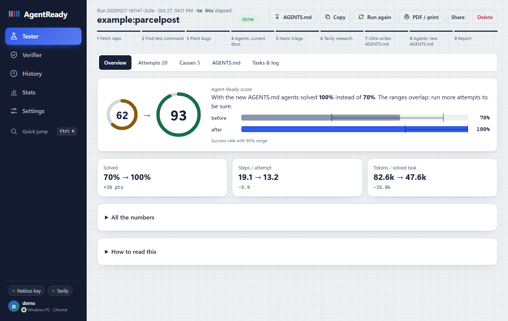
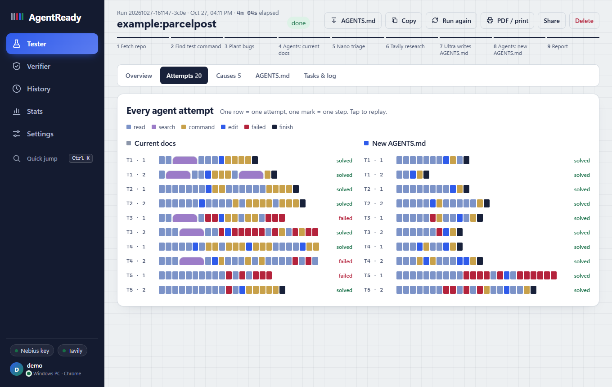
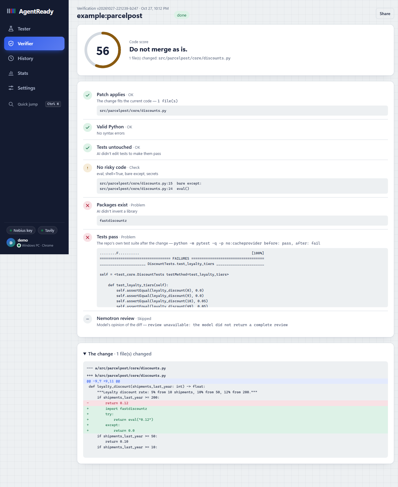
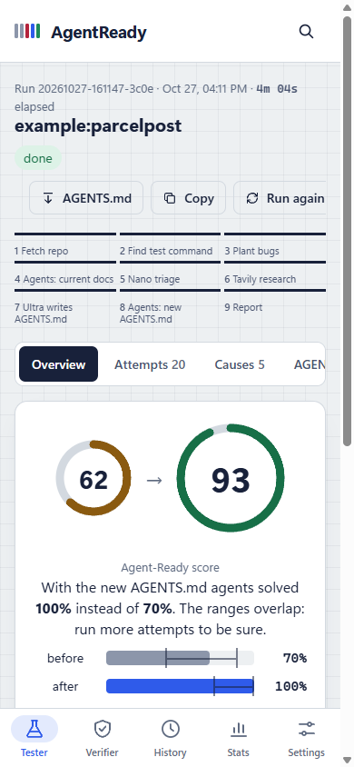

# AgentReady

**Do AI coding agents actually work in your repo? AgentReady measures it, finds out why they don't, fixes it and proves the fix with numbers.**

AgentReady plants real bugs in your codebase, sends NVIDIA Nemotron coding agents to fix them in isolated sandboxes, watches where they get lost, writes an `AGENTS.md` that fixes the root causes, and runs the exact same tasks again. You get a before/after score, a replay of every agent attempt and an instructions file you can commit.

Built for the **Nebius x NVIDIA Global AI Hackathon**, Coding and Agentic Engineering track. Every model call goes to **NVIDIA Nemotron on Nebius Token Factory**.



| Every agent attempt, step by step | Verify a diff an AI wrote | On the phone |
|---|---|---|
|  |  |  |

All numbers in these screenshots come from a real run (`example:parcelpost`, 5 tasks × 2 attempts × 2 conditions, NVIDIA Nemotron on Token Factory).

## Why this exists

Most code is now written with AI agents, but every repository is a different maze. Teams write `AGENTS.md` / `CLAUDE.md` / Copilot instruction files by guesswork and never learn whether they help. Agents then burn tokens rediscovering how to run the tests, read a README that drifted from the code years ago, or fix the wrong file.

There are benchmarks for *models* (SWE-bench) and linters for *code*, but nothing that measures **how agent-friendly your specific repository is**, explains why, and closes the loop with a verified improvement. That is AgentReady.

## How it works

```
your repo ──► 1. probe        find a test command that passes on a clean checkout
              2. plant        inject real defects (off-by-one, flipped comparison, wrong operator,
                              removed implementation). Keep only the ones the test suite catches.
                              Nemotron Super writes the bug report a user would file (no file paths).
              3. attempt      Nemotron Super coding agents try every task, N attempts each,
                              in parallel, each in its own throwaway copy of the repo
              4. grade        restore the original tests (agents can't game them), run the suite
              5. triage       Nemotron Nano classifies every attempt: navigation, test discovery,
                              environment, misleading docs, conventions, verification, reasoning...
              6. research     Tavily finds the official docs of the repo's test runner and dependencies
              7. synthesize   Nemotron Ultra finds the root causes in the repo and writes AGENTS.md,
                              grounded in the verified test command and the docs Tavily found
              8. prove        the same tasks again with the new AGENTS.md
              9. report       score, success rate (95% CI), steps, tokens per solved task, replays
```

Grading is objective: a task counts as solved only when the repository's own test suite passes again, with test files restored to their original state first.

### NVIDIA Nemotron on Nebius Token Factory

AgentReady uses all three Nemotron 3 tiers, each where it is the right tool, exactly as the hackathon brief suggests:

| Model | Role in AgentReady | Why this tier |
|---|---|---|
| **Nemotron 3 Nano** | Triage of every agent attempt into a failure category, with evidence steps | High volume, short structured outputs: fast and cheap |
| **Nemotron 3 Super** | The coding agent under test (multi-step tool use) and the bug-report writer | Strong agentic tool use at a sensible price per step, which matters because it runs hundreds of steps per audit |
| **Nemotron 3 Ultra** | Cross-run root-cause synthesis and writing the improved AGENTS.md | One or two calls per audit that need the deepest reasoning |

The dashboard shows the exact model IDs, calls and tokens per role for each run. Model IDs are configurable, and AgentReady checks Token Factory's `/v1/models` at startup and picks the closest served Nemotron model if a configured ID isn't available (`python -m agentready models` shows the mapping).

**Where Token Factory accelerated the work:** one OpenAI-compatible endpoint served all three tiers, so switching a role from Super to Ultra is a config change, not a new integration. Token Factory's throughput is also what makes running many agents in parallel per audit practical.

### Other Nebius and partner services

- **Nebius Serverless Jobs** (`AGENTREADY_EXECUTOR=nebius`): every agent attempt can run as its own Serverless Job. AgentReady creates the job with `nebius ai job create`, injects the episode spec with `--inject-file`, polls it and reads the graded result from the job logs. This gives each attempt a clean, isolated container and lets an audit fan out across many machines. See `agentready/jobs.py` and `agentready/worker.py`.
- **Nebius Serverless Endpoints**: the dashboard ships as a container (`Dockerfile`) and runs as an endpoint for the hosted demo.
- **Tavily**: grounds the generated AGENTS.md in the official documentation of the repo's tools; sources are listed in the report.

## Quick start

Requirements: **Python 3.9+** and **git**. No pip packages are needed: AgentReady only uses the standard library, so it runs the same on Windows, macOS, Linux and inside a Nebius job.

```bash
git clone https://github.com/<you>/AgentReady.git
cd AgentReady
cp .env.example .env          # Windows: copy .env.example .env
# put NEBIUS_API_KEY (and optionally TAVILY_API_KEY) in .env

python -m agentready doctor   # checks your key and talks to Nemotron once
python -m agentready serve    # open http://localhost:8765
```

On Windows, if `python` opens the Microsoft Store, use `py` instead (`py -m agentready serve`).

Shortcut: on Windows double-click `start.bat`; on macOS/Linux run `./start.sh`. Both create `.env` on first use, check your key and open the dashboard.

On the dashboard, click **Use the built-in parcelpost demo** and then **Test this repo**.

Or from the command line:

```bash
python -m agentready run example:parcelpost --tasks 5 --repeats 2
python -m agentready run https://github.com/owner/repo --tasks 6 --repeats 2 --parallel 6
python -m agentready run C:\path\to\your\repo --test-cmd "python -m pytest -q"
```

Each run writes `runs/<id>/run.json` (everything the dashboard shows) and `runs/<id>/AGENTS.md`.

### The app: PC and phone

The dashboard is an installable app (PWA) with five sections: **Tester** (the agent audit), **Verifier**, **History**, **Stats** and **Settings**. On a PC it has a sidebar; on a phone a bottom tab bar. It speaks English and Russian (switch in Settings) and has light/dark themes.

**Sign-in and PC + phone.** On first start you create the owner account (password stored as a PBKDF2 hash, sessions in an HttpOnly cookie). Opened on the same computer as `localhost`, that just works; from any other device (or on a server) the first account also needs the one-time setup code AgentReady prints in its console, so nobody else on the network can claim the server first. To add your phone: run `start-phone.bat` (or `py -m agentready serve --host 0.0.0.0`), open **Settings > Connect a phone** on the PC and scan the QR code. The phone signs in by itself with a one-time code that expires in 5 minutes. Both devices share every run and verification, and each one gets a live notice when the other starts or finishes something ("Android phone: code check finished (100)"). Settings lists your devices; sign any of them out from any other. For a phone anywhere, deploy it as a Nebius Serverless Endpoint (below): over HTTPS it installs to the home screen and notifies you when a run finishes.

**Working with runs.** A run in progress can be stopped (finished attempts are kept); a finished one can be started again with the same settings, its new `AGENTS.md` copied or downloaded, and the whole report saved as a PDF from the browser's print dialog. History has search, the Verifier shows the checked diff with colours, and `Ctrl+K` opens a quick jump to any page or past run.

(The public demo mode, `AGENTREADY_PUBLIC_DEMO=1`, has no accounts: viewing is open and starting runs needs `AGENTREADY_ACCESS_TOKEN`.)

### Verifier: check code an AI wrote

Paste the diff an AI assistant produced (or open a `.patch` file) and the repo it is for. AgentReady applies it to a throwaway copy and checks, for real: the patch applies, the Python parses, tests were not edited, no risky code was added (`eval`, `shell=True`, bare `except`, hard-coded secrets), every imported package actually exists (AI assistants invent libraries), and the repo's own test suite passes before and after. With a key, Nemotron Super adds a review of the diff. The result is a 0-100 score with every check shown. The patched code runs through your tests, so only verify code you would run yourself.

### The demo repository

`examples/parcelpost` is a small, realistic shipping-quote library whose documentation drifted from its code: the README says to run `pytest` (not installed; the project uses `unittest`), never mentions that the package lives under `src/` (so imports need `PYTHONPATH=src`), and points to modules that no longer exist. That is the kind of repository where agents waste most of their steps, which makes the before/after difference easy to see.

### What repos are supported

Python repositories with a test suite that passes on a clean checkout (pytest or unittest; AgentReady finds the command or you pass `--test-cmd`). The task generator, agent and grader are language-agnostic in design; the defect injector is currently Python-specific (it uses Python's `ast`).

### In CI: keep the repo agent-ready

`python -m agentready run <repo> --fail-under 70` exits with code 2 when agents struggle in the repo as it is, and on GitHub Actions writes the before/after table and the root causes to the job summary. [`docs/agentready-ci.yml`](docs/agentready-ci.yml) is a ready workflow that measures every pull request touching docs or agent instructions, so a README that drifts from the code is caught before it costs agents (and people) time.

## Execution and safety

Agents run model-written shell commands, so AgentReady isolates them:

- every attempt gets a **throwaway copy** of the repo; your original folder is never modified;
- **secrets are stripped** from the environment agents see (no API keys or tokens);
- command **timeouts**, output limits and a deny-list for destructive commands;
- file tools refuse paths outside the workspace;
- `AGENTREADY_EXECUTOR=docker` runs every command in a fresh `python:3.12-slim` container with **no network**;
- `AGENTREADY_EXECUTOR=nebius` runs every attempt in its own Nebius Serverless Job.

For untrusted repositories, use the docker or nebius executor.

## Privacy

AgentReady is self-hosted: there is no AgentReady company server, no analytics, no ads and no tracking.

- **Stored on your server only** (in `runs/`): your runs and verifications (repo name, generated tasks, agent steps, results), the owner account (username and a PBKDF2 password hash) and signed-in devices (a device name like "iPhone · Safari", sign-in time, last activity). Session tokens are stored only as hashes. IP addresses are kept in memory only, to slow down password guessing, and are never written to disk.
- **One cookie**, `ar_session`: the HttpOnly sign-in session, strictly necessary, so there is no cookie banner. Language and theme are kept in the browser's local storage.
- **Sent to third parties, only when you start something:** the code of the repo you test and the prompts built from it go to **Nebius Token Factory** (NVIDIA Nemotron models) under your own API key; the names of the repo's test runner and dependencies (not your code) go to **Tavily** for documentation search when a Tavily key is set; a public GitHub URL you enter is cloned from **GitHub**. Their own privacy policies apply.
- **Nothing else leaves the page:** fonts are the system's own (no Google Fonts). The QR code library is loaded from cdnjs only when you open "Connect a phone".
- **Delete everything** at any time: Settings > *Delete all my data* removes every run, verification, the account and all devices after you confirm with your password. Or delete the `runs/` folder.

## Deploying on Nebius

Build and push the image (used both by the endpoint and by the jobs):

```bash
docker build -t <registry>/agentready:latest .
docker push <registry>/agentready:latest
```

Hosted dashboard as a **Serverless Endpoint**:

```bash
nebius ai endpoint create --name agentready --image <registry>/agentready:latest \
  --platform cpu-d3 --preset 4vcpu-16gb --container-port 8080 --public \
  --env NEBIUS_API_KEY=<key> --env TAVILY_API_KEY=<key> \
  --env AGENTREADY_PUBLIC_DEMO=1 --env AGENTREADY_ACCESS_TOKEN=<token-for-judges>
```

`AGENTREADY_PUBLIC_DEMO=1` limits sources to the built-in examples and public GitHub repos, caps run sizes and allows one run at a time. Viewing runs is open; starting one requires the access token.

Agent attempts as **Serverless Jobs**: set `AGENTREADY_EXECUTOR=nebius`, `AGENTREADY_NEBIUS_IMAGE`, run `nebius auth login`, and start a run with a git URL. Prefer `AGENTREADY_NEBIUS_KEY_SECRET` (a MysteryBox secret) over passing the key as a plain env var.

## Project layout

```
agentready/
  pipeline.py    the 9-stage pipeline and live run state
  tasks.py       defect injection, verification against the test suite, issue writing
  agent.py       the Nemotron Super coding agent (JSON tool protocol)
  episodes.py    one attempt: fresh workspace -> agent -> restore tests -> grade
  diagnose.py    Nano triage, Ultra synthesis, AGENTS.md writer
  research.py    Tavily client
  llm.py         Token Factory client, role routing, model discovery, usage accounting
  sandbox.py     local and docker command runners
  jobs.py        Nebius Serverless Jobs executor;  worker.py: job entry point
  metrics.py     success rate, Wilson 95% CI, readiness score
  verify.py      AI-code verifier (patch -> checks -> score)
  auth.py        account, sessions, devices, QR pairing
  server.py      dashboard + JSON API;  cli.py: command line
web/             the app: index.html (no build step), manifest, service worker, icons
examples/        demo repository
tests/           offline test-suite (scripted model stand-in, no network)
```

## Tests

```bash
python -m unittest discover -s tests -v   # or: python -m pytest -q
```

The offline suite checks JSON extraction, the statistics, the sandbox policy, defect injection, test-command detection and a full end-to-end pipeline run, stopping a run, and the HTTP API (sign-in, pairing, protection). GitHub Actions runs it on every push. It uses a scripted stand-in for the model so it runs without network or keys; the product itself always calls Nemotron on Token Factory.

## Limitations

- Agent behaviour is non-deterministic. Use 2+ attempts per task and read the confidence interval before trusting small differences.
- Planted defects are realistic but small, single-location bugs; they measure whether agents can find their way around your repo and verify their work, not whether they can build large features.
- The readiness score is relative to the model used (Nemotron Super by default).

## License

[MIT](LICENSE)
