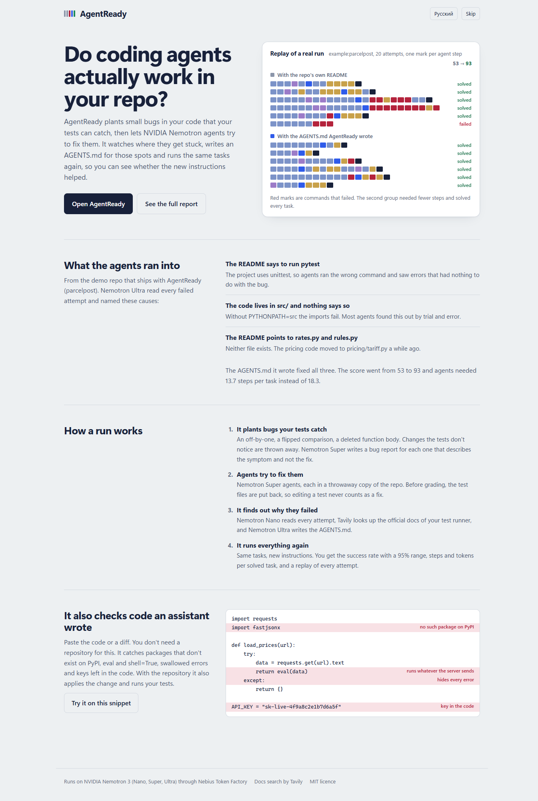

# AgentReady

AgentReady tells you whether AI coding agents can work in your repository, and where they get stuck when they can't.

It plants small bugs in a copy of your code (ones your own tests catch), lets NVIDIA Nemotron coding agents try to fix them, and records every step they take. Then it works out what tripped them up, writes an `AGENTS.md` for those spots, and runs the same tasks again with it. You end up with a before and after score, a replay of every attempt and an instructions file you can commit.

I built it for the Nebius x NVIDIA Global AI Hackathon (Coding and Agentic Engineering track). Every model call goes to NVIDIA Nemotron on Nebius Token Factory.




| Every agent attempt, step by step | Checking a diff an assistant wrote | On a phone |
|---|---|---|
|  |  |  |

The numbers in these screenshots come from a real run on `example:parcelpost` (5 tasks, 2 attempts each, with and without the new instructions).

## Why

Agents spend a surprising share of their steps on things that have nothing to do with the bug: guessing how to run the tests, following a README that stopped matching the code a year ago, opening the wrong module. Teams write `AGENTS.md`, `CLAUDE.md` or Copilot instruction files to help, but they rarely find out whether those files changed anything.

Model benchmarks such as SWE-bench compare models across many repositories. AgentReady looks at one repository, yours, and measures how well agents do there before and after a change to its instructions.

## How a run works

```
your repo ──► 1. probe        find a test command that passes on a clean checkout
              2. plant        inject small defects (off-by-one, flipped comparison, wrong operator,
                              removed implementation) and keep only the ones the tests catch.
                              Nemotron Super writes a bug report for each, without file paths
              3. attempt      Nemotron Super agents try every task, N attempts each, in parallel,
                              each in its own throwaway copy of the repo
              4. grade        put the original test files back, then run the suite
              5. triage       Nemotron Nano sorts every attempt into a failure category
                              (navigation, test discovery, environment, misleading docs, ...)
              6. research     Tavily finds the official docs of the repo's test runner and dependencies
              7. synthesize   Nemotron Ultra names the root causes and writes AGENTS.md from the
                              verified test command and the docs Tavily found
              8. prove        the same tasks again, with the new AGENTS.md
              9. report       score, success rate with a 95% interval, steps, tokens per solved task
```

A task counts as solved only when the repository's own test suite passes. Test files are restored before grading, so an agent that edits a test to make it pass gets no credit.

### How the three Nemotron models are used

| Model | What it does here | Why this size |
|---|---|---|
| Nemotron 3 Nano | Reads each agent attempt and labels why it failed, citing the steps | Many short, structured calls |
| Nemotron 3 Super | Is the coding agent under test, and writes the bug reports | Good at multi-step tool use; it makes hundreds of calls per run, so price per step matters |
| Nemotron 3 Ultra | Reads all the triage results, names root causes and writes AGENTS.md | One or two calls per run that need the most reasoning |

Each run shows the exact model IDs, call counts and tokens per role. Model IDs are configurable. At startup AgentReady asks Token Factory's `/v1/models` which models are served and falls back to the closest Nemotron model when a configured ID is missing; `python -m agentready models` prints the mapping.

All three models sit behind one OpenAI-compatible Token Factory endpoint, so moving a role from Super to Ultra is a one-line config change. Running many agents in parallel depends on Token Factory's throughput.

### Other Nebius and partner services

With `AGENTREADY_EXECUTOR=nebius`, every agent attempt runs as its own Nebius Serverless Job. AgentReady creates the job with `nebius ai job create`, passes the attempt in with `--inject-file`, polls it and reads the graded result from the job logs (`agentready/jobs.py`, `agentready/worker.py`). The dashboard itself ships as a container (`Dockerfile`) that runs as a Nebius Serverless Endpoint. Tavily supplies the documentation that the generated AGENTS.md cites, and the report lists those sources.

## Quick start

You need Python 3.9 or newer and git. There are no pip packages to install; AgentReady uses only the standard library.

```bash
git clone https://github.com/<you>/AgentReady.git
cd AgentReady
cp .env.example .env          # Windows: copy .env.example .env
# put NEBIUS_API_KEY (and optionally TAVILY_API_KEY) in .env

python -m agentready doctor   # checks your key and talks to Nemotron once
python -m agentready serve    # open http://localhost:8765
```

On Windows, if `python` opens the Microsoft Store, use `py` instead (`py -m agentready serve`). You can also double-click `start.bat` (or run `./start.sh` on macOS and Linux); both create `.env` the first time, check the key and open the dashboard.

In the app, click "Try the parcelpost demo", then "Test this repo". From the command line:

```bash
python -m agentready run example:parcelpost --tasks 5 --repeats 2
python -m agentready run https://github.com/owner/repo --tasks 6 --repeats 2 --parallel 6
python -m agentready run C:\path\to\your\repo --test-cmd "python -m pytest -q"
```

Each run writes `runs/<id>/run.json`, which holds everything the dashboard shows, and `runs/<id>/AGENTS.md`.

### The app

The dashboard installs as an app (PWA) on a PC or a phone. It has five sections: Tester, Verifier, History, Stats and Settings, a sidebar on a PC and a tab bar on a phone, English and Russian, and light and dark themes. New visitors first see a short intro at `/welcome`.

A run in progress can be stopped; attempts that already finished are kept. A finished run can be repeated with the same settings, and its report saved as a PDF from the browser's print dialog. History is searchable, and `Ctrl+K` jumps to any page or past run. On a phone you can share a GitHub link to AgentReady from any app and it opens in the Tester, ready to run.

### Accounts

You sign in with an email. Each account sees only its own runs, checks, stats and activity; opening someone else's run by its link returns a 404. The first account is created on the computer that runs AgentReady. From another device that first sign-up also needs the one-time setup code printed in the console, so nobody else on the network can claim the server first.

Other people join on that computer or with an invite link (Settings, "Invite someone", one use, valid 24 hours). On a public demo server, `AGENTREADY_SIGNUP=open` lets anyone sign up. Every account can make the server run the tests of a repository it chooses, so use the docker or nebius executor on such a server. Runs saved before accounts existed belong to the first account.

To use your phone with the same account, start AgentReady with `start-phone.bat` (or `py -m agentready serve --host 0.0.0.0`), open Settings, "Connect a phone" on the PC and scan the QR code. The phone signs in with a one-time code that expires after 5 minutes. Both devices then see the same runs, and each gets a notice when the other starts or finishes something. To reach the app from outside your Wi-Fi, deploy it as a Nebius Serverless Endpoint (below); over HTTPS it installs to the home screen and can notify you when a run finishes.

The public demo mode (`AGENTREADY_PUBLIC_DEMO=1`) has no accounts. Anyone can view runs, and starting one needs `AGENTREADY_ACCESS_TOKEN`.

### Verifier

Paste code an assistant gave you, or a diff, and click Verify. You can leave the repository field empty: the code is then checked on its own for syntax errors, `eval`, `shell=True`, bare `except`, keys written into the code, and imports of packages that don't exist on PyPI (assistants make these up). With a key, Nemotron Super also reviews it.

If you add the repository, AgentReady applies the diff to a throwaway copy, checks that the tests were not edited, and runs the repo's test suite before and after the change. The result is a score from 0 to 100 with every check listed. The patched code runs through your tests, so only verify code you would be willing to run.

### The demo repository

`examples/parcelpost` is a small shipping-quote library whose README no longer matches its code. It says to run `pytest`, but the project uses `unittest`. It never mentions that the package lives under `src/`, so imports fail without `PYTHONPATH=src`. It also points to modules that were renamed. Agents lose most of their steps on repositories like this, which makes the before and after difference easy to see.

### Supported repositories

Python repositories whose test suite passes on a clean checkout, with pytest or unittest. AgentReady finds the test command, or you pass `--test-cmd`. The agent and the grader don't depend on the language, but the defect injector uses Python's `ast`, so other languages need their own injector.

### In CI

`python -m agentready run <repo> --fail-under 70` exits with code 2 when the repo's score is below 70. On GitHub Actions it also writes the before and after table and the root causes to the job summary. [`docs/agentready-ci.yml`](docs/agentready-ci.yml) is a workflow that runs it on pull requests that change docs or agent instructions, which catches a README that has drifted from the code.

## Execution and safety

Agents run shell commands that a model wrote. AgentReady limits what they can do:

- each attempt works in a throwaway copy of the repo, and your folder is never modified;
- API keys and tokens are removed from the environment the agents see;
- commands have timeouts and output limits, and a deny-list blocks obviously destructive ones;
- the file tools refuse paths outside the workspace;
- with `AGENTREADY_EXECUTOR=docker`, every command runs in a fresh `python:3.12-slim` container without network access;
- with `AGENTREADY_EXECUTOR=nebius`, every attempt runs in its own Nebius Serverless Job.

Finding the test command runs the repository's tests on the machine that hosts AgentReady, whichever executor you pick. Use the docker or nebius executor, on a machine you don't mind, for repositories you don't trust.

## Privacy

AgentReady is self-hosted. It has no analytics, ads or tracking, and there is no AgentReady server it reports to.

It stores, in `runs/` on your machine: runs and checks (repository name, generated tasks, agent steps and results), accounts (email and a PBKDF2 password hash) and signed-in devices (a name such as "iPhone · Safari", sign-in time, last activity). Session tokens are stored only as hashes. IP addresses stay in memory, where they slow down password guessing, and are never written to disk.

The only cookie is `ar_session`, the HttpOnly sign-in session. It is strictly necessary, so there is no cookie banner. Language and theme are kept in the browser's local storage.

Data leaves your machine only when you start something. The code of the repository you test, and prompts built from it, go to Nebius Token Factory under your API key. The names of the repo's test runner and dependencies (not the code) go to Tavily when a Tavily key is set. A GitHub URL you enter is cloned from GitHub. The app uses system fonts, so it makes no font requests, and it loads a QR code library from cdnjs only when you open "Connect a phone".

Settings, "Delete all my data" removes your runs, checks, account and devices after you enter your password. Other accounts are not touched. Deleting the `runs/` folder removes everything.

## Deploying on Nebius

Build and push the image (the endpoint and the jobs both use it):

```bash
docker build -t <registry>/agentready:latest .
docker push <registry>/agentready:latest
```

The dashboard as a Serverless Endpoint:

```bash
nebius ai endpoint create --name agentready --image <registry>/agentready:latest \
  --platform cpu-d3 --preset 4vcpu-16gb --container-port 8080 --public \
  --env NEBIUS_API_KEY=<key> --env TAVILY_API_KEY=<key> \
  --env AGENTREADY_PUBLIC_DEMO=1 --env AGENTREADY_ACCESS_TOKEN=<token-for-judges>
```

`AGENTREADY_PUBLIC_DEMO=1` accepts only the built-in examples and public GitHub repos, caps run sizes and allows one run at a time.

To run agent attempts as Serverless Jobs, set `AGENTREADY_EXECUTOR=nebius` and `AGENTREADY_NEBIUS_IMAGE`, run `nebius auth login`, and start a run with a git URL. Pass the key as a MysteryBox secret with `AGENTREADY_NEBIUS_KEY_SECRET` rather than as a plain environment variable.

## Project layout

```
agentready/
  pipeline.py    the 9-stage pipeline and live run state
  tasks.py       defect injection, checking it against the test suite, bug reports
  agent.py       the Nemotron Super coding agent (JSON tool protocol)
  episodes.py    one attempt: fresh workspace -> agent -> restore tests -> grade
  diagnose.py    Nano triage, Ultra synthesis, AGENTS.md writer
  research.py    Tavily client
  llm.py         Token Factory client, role routing, model discovery, usage accounting
  sandbox.py     local and docker command runners
  jobs.py        Nebius Serverless Jobs executor;  worker.py: job entry point
  metrics.py     success rate, Wilson 95% interval, readiness score
  verify.py      code checker (code or diff -> checks -> score)
  auth.py        accounts, invites, sessions, devices, QR pairing
  server.py      dashboard and JSON API;  cli.py: command line
web/             the app: index.html (no build step), manifest, service worker, icons
examples/        demo repository
tests/           offline tests (a scripted stand-in for the model, no network)
```

## Tests

```bash
python -m unittest discover -s tests -v   # or: python -m pytest -q
```

The tests run offline against a scripted stand-in for the model. They cover JSON extraction, the statistics, the sandbox policy, defect injection, test-command detection, a full pipeline run, stopping a run, the code checker with and without a repository, and the HTTP API: sign-in, separate accounts, invites, pairing and CSRF protection. GitHub Actions runs them on every push.

## Limitations

- Agents are non-deterministic. Use at least two attempts per task, and check whether the 95% intervals overlap before trusting a small difference.
- The planted defects are small bugs in one place. They show whether agents can find their way around your repo and check their own work. They say little about building large features.
- The score depends on the model under test (Nemotron Super by default).

## License

[MIT](LICENSE)
